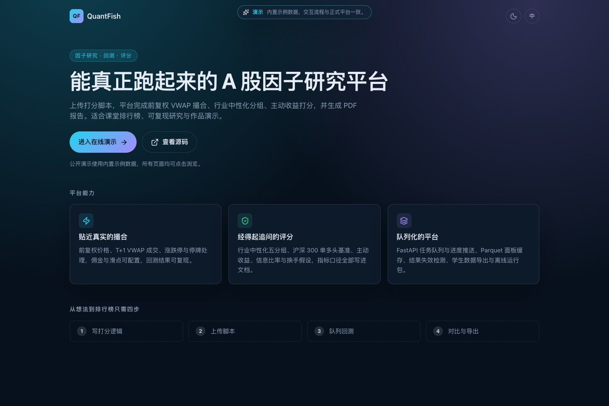
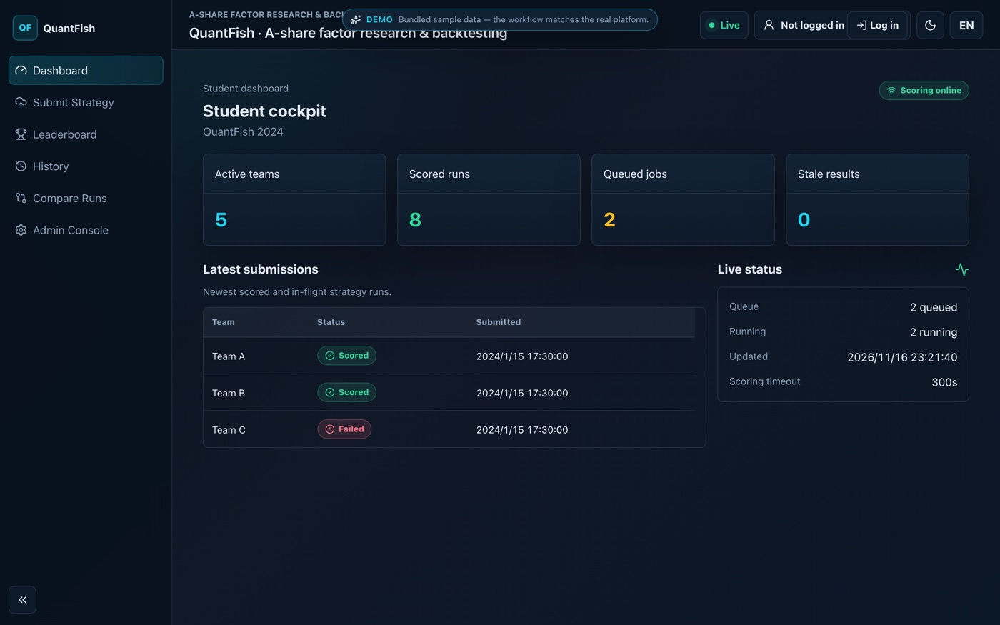
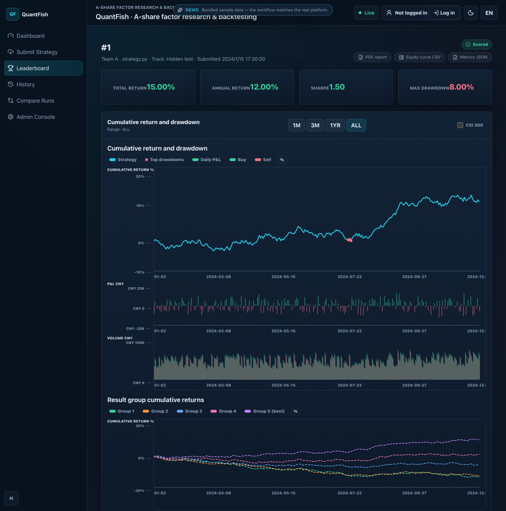
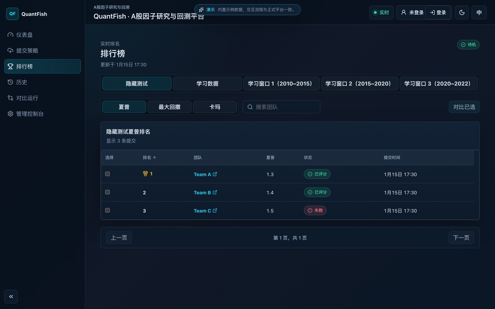
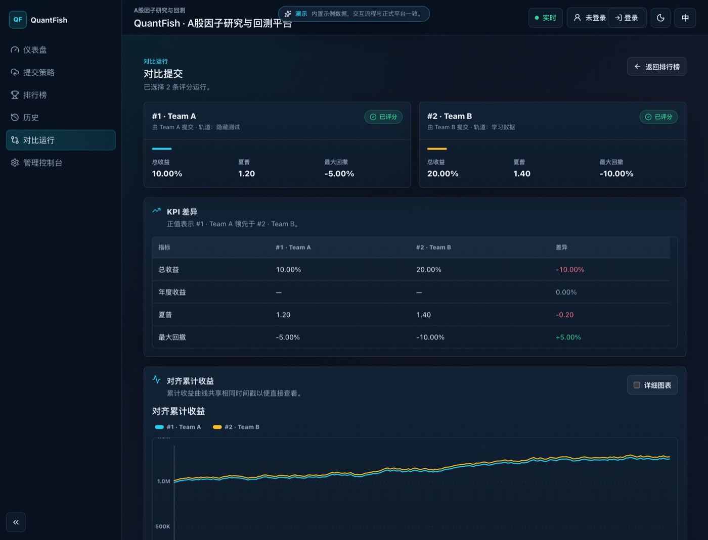

<div align="center">

# QuantFish

**An A-share factor research and backtesting platform you can actually run.**

Write a scoring script → the platform queues a real backtest with forward-adjusted
VWAP fills, industry-neutral quintiles and long-only HS300 scoring → then shows you a
leaderboard, a run comparison and a PDF report.

[**Live demo**](https://FreeFish0904.github.io/QuantFish/) ·
[Docker demo](#-quickstart) ·
[Architecture](docs/architecture.md) ·
[Metric definitions](docs/metrics-definitions.md) ·
[Contributing](CONTRIBUTING.md)

[](https://github.com/FreeFish0904/QuantFish/actions/workflows/ci.yml)
[](https://github.com/FreeFish0904/QuantFish/actions/workflows/pages.yml)
[](LICENSE)


</div>



QuantFish started life as a classroom platform: students upload a `generate_signals.py`,
the platform scores it on hidden market data, and a leaderboard ranks the cohort. It grew
into a complete research loop — data releases, a point-in-time execution engine, queued
scoring workers, result staleness tracking, and a demo that runs the *real* engine on a
generated dataset.

## Why it is interesting

- **The engine is real.** Forward-adjusted prices, T+1 VWAP fills, price-limit and
  suspension handling, participation caps, commission/slippage/stamp duty, and a
  long-only path with beta-adjusted active returns.
- **The platform is real.** FastAPI + SQLite + a thread/process scoring queue, cached
  parquet panels, job progress streaming, stale-result detection, admin console, team
  cohorts, student data exports and offline runtime bundles.
- **Everything is tested.** 387 backend tests (pytest) and 224 frontend tests
  (vitest + Testing Library + MSW), plus a CI matrix on Python 3.12/3.13.
- **The demo is honest.** The public demo is a static build with an in-browser mock API;
  the Docker demo generates a synthetic CSMAR-style dataset and runs the actual engine,
  queue and report writer.

## Screenshots

| Dashboard | Run detail |
| --- | --- |
|  |  |

| Leaderboard | Run comparison |
| --- | --- |
|  |  |

## 🚀 Quickstart

### Option 1 — Docker, one command, real backtest (recommended)

```bash
git clone https://github.com/FreeFish0904/QuantFish.git
cd quantfish
docker compose -f deploy/docker-compose.yml up --build
```

Open <http://localhost:8010>. On first boot the container

1. generates a synthetic dataset (60 symbols, 2018–2024) with
   `scripts/gen_sample_dataset.py`,
2. materialises the `learning` / `hidden_test` releases through the normal
   `quantfish.data.releases` pipeline,
3. queues two demo submissions, which the running dispatcher scores **with the real
   engine** (watch them move `queued → running → completed`).

### Option 2 — Local development

```bash
python3 -m venv .venv && source .venv/bin/activate
python -m pip install -e './backend[dev,pdf]'
npm --prefix frontend install

scripts/start-quantfish.sh --mode dev            # API + Vite dev server
npm --prefix frontend run build                  # then a production-style build
scripts/start-quantfish.sh --mode prod --port 8010
```

To work against the bundled synthetic data instead of a licensed dataset:

```bash
python scripts/gen_sample_dataset.py
scripts/start-quantfish.sh --mode prod --port 8010 --config config/platform.demo.yaml
```

### Option 3 — Static, backend-free demo (GitHub Pages)

```bash
VITE_DEMO_MODE=true npm --prefix frontend run build   # then serve frontend/dist
```

`VITE_DEMO_MODE=true` boots an MSW service worker (`src/mocks`) that answers the whole
REST surface, switches to hash routing and shows a demo banner, so the UI can be hosted
with no server at all. `.github/workflows/pages.yml` publishes it on every push to `main`.

## How a submission is scored

1. **Upload** — `POST /api/submissions` validates a Python script, stores it and enqueues
   a job (per-team cooldown, configurable timeout).
2. **Score worker** — a separate process runs the strategy through
   `quantfish.factor_execution`, resolves the configured data track (`hidden_test` or a
   historical `learning_*` window) and builds the panel.
3. **Panel** — raw CSMAR-style tables are joined as-of, front-adjusted with
   `cumulatefwardfactor`, filtered by market type, listing age and trading status, then
   cached (`panel_cache`) so repeated runs stay cheap.
4. **Execution** — signals on day *t* are filled at day *t+1* VWAP with limit-up /
   limit-down and suspension rules, participation caps and costs; long-only mode ranks
   names and weights them by rank.
5. **Evaluation** — quintile group returns, industry neutralisation, Sharpe, drawdown,
   turnover, Calmar/fitness and beta-adjusted active returns vs HS300, each reported on the
   arithmetic (scored) and the geometric (compounded CAGR, Sortino, t-stat) basis — see
   [docs/metrics-definitions.md](docs/metrics-definitions.md).
6. **Delivery** — `summary.csv`, `graph_data.json`, parquet artifacts and an optional PDF
   report land in `runs/web_platform/reports/<submission-id>/`; the UI renders them and
   flags runs as *stale* when the config or data release changes.

## Engineering notes

- **One config, validated.** `config/platform.yaml` (or `platform.demo.yaml`) is parsed into
  a frozen dataclass tree with cross-field validation; the admin console edits it through
  the same object, and the leaderboard reports the scoring timeout from that single source.
- **Auto-detected data contract.** `scan_catalog` recognises `distribute/`, `teacher/`,
  CSV and parquet variants, so the same code reads a licensed CSMAR export and the
  synthetic demo dataset. The column contract is documented in
  [docs/architecture.md](docs/architecture.md).
- **Two languages, no duplication.** Every screen uses `t("namespace.key")` against an
  `en`/`zh` dictionary; the default language follows `navigator.language` until the user
  picks one.
- **Charts without a chart library.** `frontend/src/shared/charts` renders the equity,
  drawdown, PnL, volume and group curves as hand-written, theme-aware SVG (no runtime
  chart dependency, geometry is unit-tested).
- **Staleness instead of silent drift.** Each run stores a fingerprint of the config and
  data release; when either changes, old runs are marked stale instead of being compared
  as if they were comparable.
- **Offline classroom kit.** `quantfish.student_exports` builds student data zips and
  conda-packed offline runtimes with a dependency-signature manifest, so a classroom can
  work without internet access.

## Repository layout

```text
backend/src/quantfish/   FastAPI app, engine, scoring queue, data releases, exports
backend/tests/           pytest suite
frontend/                React 19 + Vite SPA (features/* = one folder per screen)
frontend/src/mocks/      MSW handlers powering the tests and the static demo
config/                  platform.yaml (classroom) and platform.demo.yaml (demo)
deploy/                  Dockerfile, compose file, entrypoint, demo seeding
docs/                    architecture, student handbook, guides, screenshots
examples/                runnable example strategies
scripts/                 dataset generator, launchers, backups, runtime builders
data/                    generated dataset location (git-ignored, see data/README.md)
```

## Testing

```bash
python -m pytest backend/tests -q              # 387 passed
npm --prefix frontend test -- --run            # 224 passed
npm --prefix frontend run build                # tsc -b && vite build
```

The suite covers the engine (panel construction, price adjustment, limits, metrics), the
API (auth, submissions, leaderboards, admin), export bundling, script contracts and every
frontend feature (view + model tests) with MSW as the API double.

## Roadmap

- [ ] Postgres + Alembic migrations instead of SQLite
- [ ] Progress over WebSocket instead of polling
- [ ] Intraday / minute-bar datasets
- [ ] Factor library with IC/IR analysis and factor correlation reports
- [ ] Replayable benchmark snapshots per course cohort

## Data and disclaimer

No market data is redistributed in this repository. The Docker and CI demos use a
**synthetic** dataset produced by `scripts/gen_sample_dataset.py`: simulated prices,
volumes, industries and a deliberately weak embedded signal, none of which carry market
information. A real deployment points `data_releases.raw_data_root` at a licensed
CSMAR-style export.

Nothing here is investment advice.

## License

[MIT](LICENSE) © 2026 QuantFish contributors
