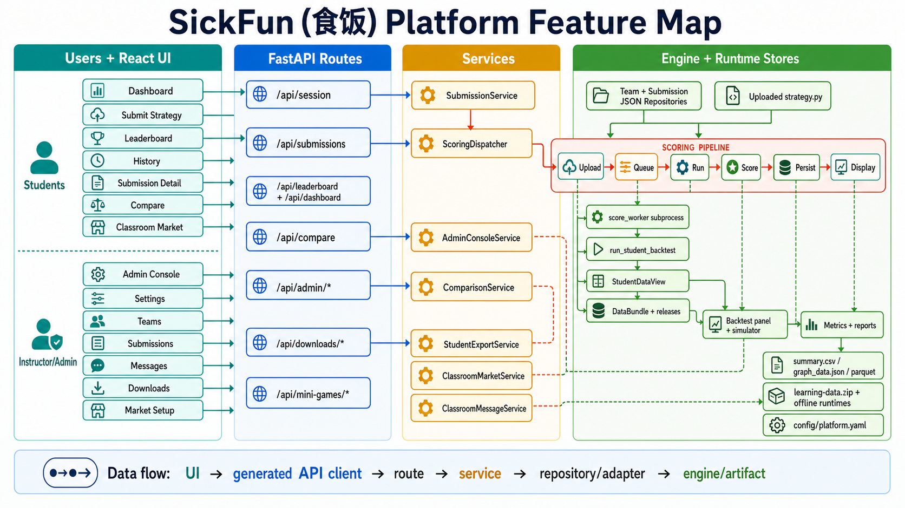

# QuantFish Platform Feature Map

## Current Feature Surface

QuantFish is a classroom factor-research and backtesting platform with three major audiences:

- Students use team login, download learning materials, upload `strategy.py`, monitor run status, inspect their results, and compare submissions.
- Instructors use the admin console to manage teams, platform settings, submissions, and student downloads.
- Maintainers operate the data releases, backtest engine, runtime stores, offline runtime packages, and generated API contract.

## Frontend Layer

The React app is organized around route-owned features in `frontend/src/features/`:

- Dashboard: course status, runner status, KPIs, latest submissions.
- Submit Strategy: team credentials, learning/hidden track selection, upload, status polling, learning-data and environment downloads.
- Leaderboard: best-per-team ranked results.
- History: all uploads, filtering, stale status, compare selection.
- Submission Detail: metrics, score breakdown, graph data, execution parameters, performance table.
- Compare: multi-submission equity, drawdown, group returns, and execution-parameter comparison.
- Admin Console: settings, teams, submissions, and related management panels.

## Backend Layer

FastAPI wires feature-owned routers in `backend/src/quantfish/web_app/app.py`:

- `/api/session` handles participant session login/logout.
- `/api/submissions` handles strategy upload, history, options, and detail payloads.
- `/api/submissions/validate` dry-runs an upload (last ~20 trading dates, no persistence,
  6 requests/minute per team) so a student can fix errors before submitting.
- `/api/leaderboard` and `/api/dashboard` expose ranked and overview views.
- `/api/compare` combines artifacts for selected submissions.
- `/api/admin/*` handles admin auth, settings, teams, submissions, source/error viewing, and downloads.
- `/api/admin/failures` groups the failures of the last N days by likely cause (timeout, stale
  positions, invalid signals, worker crash, data release) so an instructor can triage a class
  upload from the submissions tab instead of opening raw errors one by one.
- `/api/downloads/*` serves learning data and optional platform runtime zips.
- `/api/health` is the liveness ping and `/api/ready` is the readiness probe (runtime
  directory, submission store, platform config, frontend bundle, scoring dispatcher); see
  [observability.md](observability.md) for the payload and the log format.

## Service And Engine Flow

The core scoring path is:

1. `POST /api/submissions` stores the uploaded strategy and creates a queued submission.
2. `SubmissionScoringDispatcher` pumps queued work under `max_concurrent_scoring`.
3. `BacktestSubmissionRunner` starts a `score_worker` subprocess.
4. `score_worker` calls `run_student_backtest(...)` and writes report artifacts.
5. `execute_student_strategy(...)` loads the student module and gives it a date-bound `StudentDataView`.
6. `DataBundle` reads the configured learning or hidden release with market-type filtering.
7. `build_backtest_panel(...)`, optional industry neutralization, and `simulate_backtest(...)` produce positions and daily returns.
8. Metrics, graph data, diagnostics, yearly performance, and summary files are persisted.
9. Dashboard, leaderboard, history, detail, admin, and compare features read those repositories and artifacts.

## Runtime Stores And Config

The main runtime contracts are:

- `config/platform.yaml`: course, data windows, scoring weights, execution settings, market scope, queue limits, and backtest parameters.
- `runs/web_platform/repositories/`: JSON-backed teams and submissions.
- `runs/web_platform/submissions/`: uploaded student strategies.
- submission report directories: `summary.csv`, `graph_data.json`, `diagnostics.json`, yearly CSV, and parquet series.
- `data_releases/learning`, `learning_1`, `learning_2`, `learning_3`, and `hidden_test`: independently configured date-windowed releases built from licensed raw data.
- `runs/web_platform/exports/student/`: `learning-data.zip` and available offline environment kits.
